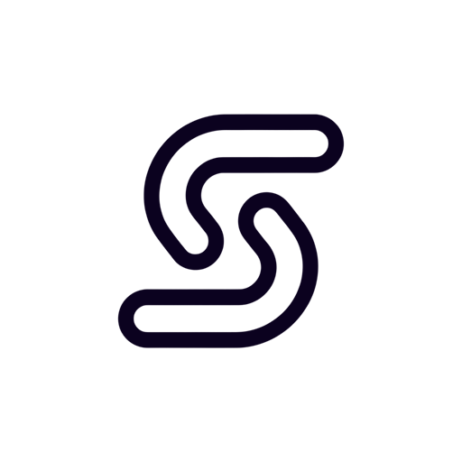
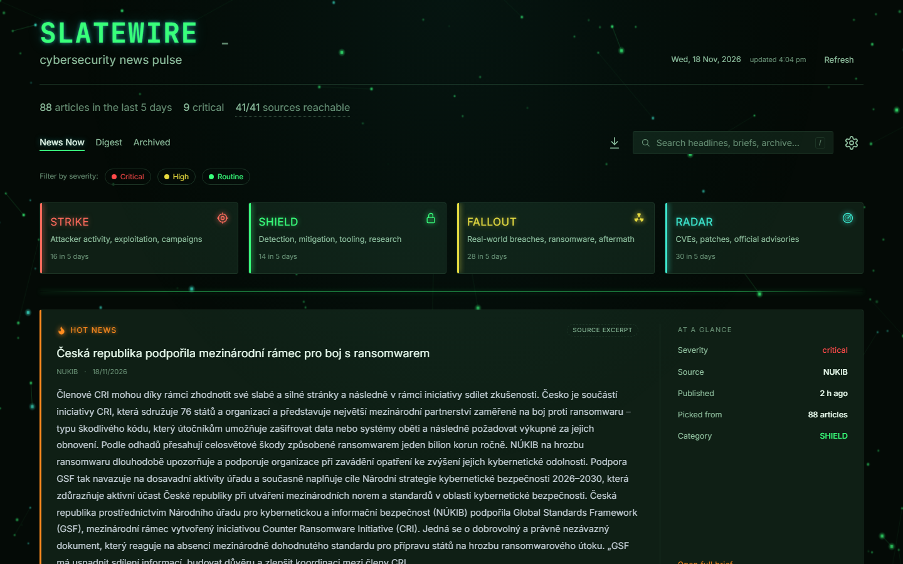
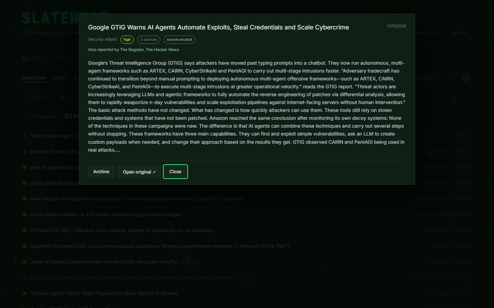
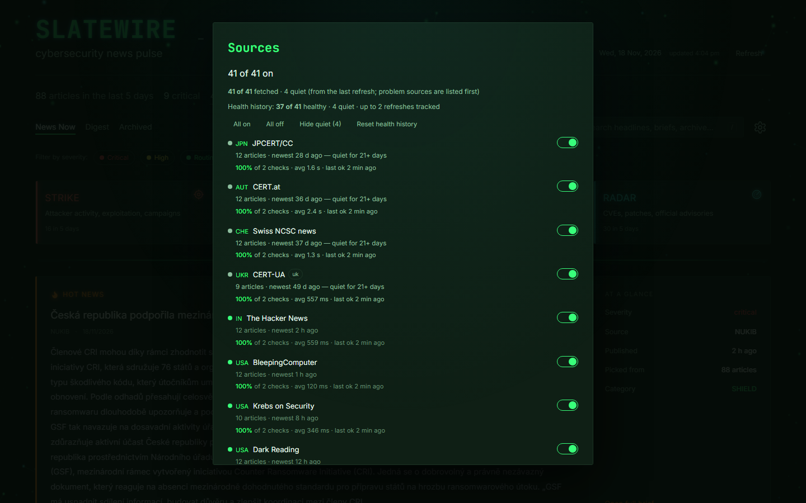

<p align="center">
  <picture>
    <source media="(prefers-color-scheme: dark)" srcset="docs/logo-dark.png">
    
  </picture>
</p>

<h1 align="center">SLATEWIRE</h1>

<p align="center">A local-first desktop cybersecurity news reader for Windows.</p>

<p align="center">
  <a href="https://github.com/aravind98jayan/slatewire/releases/latest"></a>
  <a href="LICENSE"></a>
  
</p>

<p align="center">
  <a href="https://github.com/aravind98jayan/slatewire/releases/latest"><strong>Download the latest release</strong></a>
  &nbsp;·&nbsp;
  <a href="slatewire/README.md">Documentation</a>
  &nbsp;·&nbsp;
  <a href="slatewire/CHANGELOG.md">Changelog</a>
</p>

---

SLATEWIRE pulls live RSS/Atom feeds from 41 sources across 30 countries -- government CERTs, vendor research
labs and security newsrooms -- and turns them into a single desktop dashboard. It runs entirely on your PC:
no account, no cloud sync, no telemetry. AI briefs are optional and use your own Google Gemini key.

## Screenshots

**Dashboard** -- hot news, severity-sorted category tiles and the source map on one page.



**Article brief** -- open any row to see the brief, the other sources running the
same story, and the archive / open-original actions.



**Sources** -- health per feed and one switch per feed; quiet feeds are marked,
not hidden.



Captured without a Gemini key, so the brief shows the source text (`SOURCE EXCERPT`). With a key the same
card holds an English summary.

## What it does

- **Live feed, sorted for you** -- severity (critical / high / routine), category tiles, same-story
  clustering, and a globe that lights the countries a story comes from.
- **AI briefs, only if you want them** -- short summaries in the article card, Hot News and the daily digest,
  written in English from articles in any language. Without a key you get the source excerpt in its original
  language instead.
- **CISA KEV enrichment** -- "KNOWN EXPLOITED" badges, ransomware links and remediation due dates.
- **Search and archive** -- full-text search with filters, saved presets and a local archive with your own notes.
- **Daily digest** -- a local summary of the last N hours of the feed.
- **Source watchdog** -- a feed that keeps failing for a permanent reason is retired instead of retried
  forever; retired feeds can be restored with one click. Quiet feeds are marked, not treated as failures.
- **Custom feeds** -- add any RSS/Atom URL or import an OPML file from the Sources panel.
- **Notifications** -- optional Windows task checks every 30 minutes while you are logged in and can toast
  IMPORTANT or Catch-up stories. Toggled from Settings; it does nothing while the window is open.
- **Export** -- the current feed, a category, the archive, a search or the digest as Markdown, CSV or JSON.
- **Yours** -- themes, text scale, per-source switches, reduced-motion support, and all data stored next to
  the app.

## Install (Windows 10/11)

1. Download **`SLATEWIRE-v1.13.0-windows.zip`** from the
   [latest release](https://github.com/aravind98jayan/slatewire/releases/latest).
2. Extract it to `C:\SLATEWIRE` (not `Program Files` -- the app saves its data next to itself).
3. Double-click **`INSTALL.bat`**. If SmartScreen says "Windows protected your PC", choose
   **More info -> Run anyway**. Wait for "Done."
4. Start SLATEWIRE from the Desktop shortcut or `SLATEWIRE.bat`.

`INSTALL.bat` creates a private Python environment, installs the dependencies, creates the Desktop
shortcut (with the app icon) and offers to turn on background notifications. No administrator rights are
needed.

**Needs:** Python 3.12 or 3.13 from [python.org](https://www.python.org/downloads/windows/) (tick
"Add python.exe to PATH"), the Microsoft Edge WebView2 runtime (already on Windows 11 and most updated
Windows 10), and internet for the first install.

Full instructions, troubleshooting and uninstall notes are in
[`README_WINDOWS.txt`](README_WINDOWS.txt). If the window does not open, run `SLATEWIRE-debug.bat` and
read the error.

## Optional: AI briefs

AI briefs use your own Google Gemini key. Create a free one at <https://aistudio.google.com/apikey> (no
credit card), then open **Settings -> AI briefs** in the app, paste it and press **Save** (Enter also
saves). The key is stored in `%APPDATA%\SLATEWIRE\secrets.json`, outside the app folder, so updates never
erase it, and it is never sent back to the page.

A key does two jobs: it writes the brief, and it translates. Non-English articles are summarised in English.
Without a key, cards fall back to the article's own text -- correctly decoded, but **in its original
language**, because translation is part of the AI brief and nothing is machine-translated locally.

If you prefer a file, set the environment variable `SLATEWIRE_GEMINI_API_KEY` before launching, or paste
the key into `slatewire/config.py` where it says `paste-your-key-here`. The order is: a key saved in
Settings, then `config.py` / the environment variable, then no key at all.

The default model is `gemini-flash-lite-latest`, which is fast on the free tier; `BRIEF_MODEL` and
`BRIEF_MODEL_FALLBACK` in `config.py` can be changed. **Never commit a real key.** The key is only sent
to Google's Gemini API, and only when you ask for a brief or digest.

## Privacy

Everything SLATEWIRE stores lives next to the app in the `slatewire` folder: `archive.json`, `history.json`,
`read.json`, `settings.json`, `source_health.json`, `briefs_cache.json`, `custom_sources.json` and the
notifier's `logs/` folder. Delete those files to start fresh. The one exception is a Gemini key saved in
Settings, which lives in `%APPDATA%\SLATEWIRE\secrets.json` so updates keep it; **Remove** in Settings
deletes it. The only outbound requests are the news feeds you have enabled and, if you added a key, the
Gemini API. There is no account and no telemetry.

## Run from source

```bat
git clone https://github.com/aravind98jayan/slatewire.git
cd slatewire
py -3.12 -m venv .venv
.venv\Scripts\pip install -r slatewire\requirements.txt
.venv\Scripts\python slatewire\app.py
```

Run the tests from the `slatewire` folder:

```bat
python -m unittest discover -s tests
```

The suite is 203 tests. The backend is Flask (local only, `127.0.0.1`); the window is pywebview with the
Edge WebView2 backend.

## Repository layout

```
slatewire/              application, static page, tests and documentation
docs/                   logo and screenshots used by this README
INSTALL.bat             creates .venv, installs dependencies, makes the shortcut
SLATEWIRE.bat           starts the app
SLATEWIRE-debug.bat     starts it with a console, for troubleshooting
UNINSTALL.bat           removes the shortcut and .venv (keeps your data)
ENABLE/DISABLE-NOTIFICATIONS.bat   manual fallback for the Settings switch
README_WINDOWS.txt      end-user install and troubleshooting guide
```

## License

MIT. See [LICENSE](LICENSE).

Contact: `decyfer98@proton.me` (also in the app's About panel).
